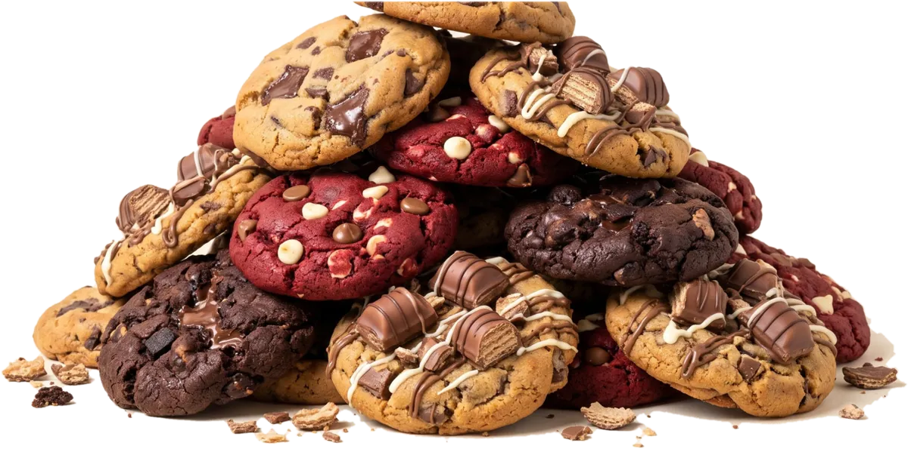

<p align="center"></p>

# La Cookie Locaa 🍪

> Cookies loucas. Receitas simples.

Site com as três receitas de cookies da La Cookie Locaa, cada uma para 6 cookies:

| Cookie | O que é |
|---|---|
| **Cookie de Chocolate Recheada** | Massa de chocolate com recheio de mousse de chocolate |
| **Cookie Kinder Bueno** | Com pedaços de Kinder Bueno e recheio de Nutella |
| **Cookie Red Velvet** | Red velvet com chocolate branco e de leite |

## O que o site faz

- **Página inicial**: cabeçalho fixo com pesquisa sempre visível (também por ingrediente: "tenho Kinder em casa"); hero; as 3 cookies; tabela de calorias de cada cookie; sobre o chef; galeria "fiz e ficou assim"; newsletter; rodapé.
- **Página de cada cookie**: botão "Saltar para a receita", ingredientes em gramas com a medida em chávenas/colheres ao lado, doses ajustáveis, passos com os ingredientes de cada passo, temporizadores, e schema Recipe para o Google.
- **Calorias**: estimadas a partir dos ingredientes (tabela `NUTRI` em `js/receitas.js`), por cookie. Aparecem na página inicial, em cada receita e no schema Recipe.
- **Lista de compras** (`lista.html`): um talão que junta e soma os ingredientes das receitas escolhidas.
- **Livro de receitas**: [`livro.html`](livro.html) para imprimir, ou o PDF em [`docs/`](docs/Livro-La-Cookie-Locaa.pdf).
- Modo escuro automático, navegação por teclado e `prefers-reduced-motion` (desliga as animações).

## Coisas para trocares

| O quê | Onde |
|---|---|
| A tua foto (Sobre o chef) | `assets/img/eu.webp` (enquanto não existir, aparece a mascote) |
| A mascote | `assets/img/mascote.webp` |
| Fotos "fiz e ficou assim" | `COMUNIDADE` em `js/receitas.js`: `{ foto, nome, receita, texto }` |
| Newsletter | `NEWSLETTER_ACAO` em `js/receitas.js`: o URL do formulário do serviço (Buttondown, MailerLite, Brevo…) |

## Estrutura

```
kingGcookies/
├── index.html, lista.html, cookie-*.html   ← geradas por ferramentas/gerar.js
├── livro.html            ← livro de receitas para imprimir (A4)
├── css/site.css          ← cores, letras e layout (claro e escuro)
├── css/fontes.css        ← fontes do livro
├── js/receitas.js        ← AS RECEITAS (muda quantidades e passos aqui)
├── js/app.js             ← a lógica do site
├── ferramentas/gerar.js  ← gera as páginas HTML
├── assets/img/           ← fotos (WebP), ícones, mascote
└── docs/Livro-La-Cookie-Locaa.pdf
```

## Mudar uma receita

Abre `js/receitas.js`. Cada receita tem `grupos` (ingredientes) e `passos`; cada passo tem uma `fase`, que define o agrupamento na cronologia.
As quantidades são para 6 cookies; o site faz as contas para outras doses.
Nos passos, `{N}` é trocado pelo número de cookies escolhido.

Cada ingrediente tem `p: [números dos passos]` onde é usado, para as quantidades aparecerem nesses passos.
Depois de mudares alguma coisa, volta a gerar as páginas:

```bash
node ferramentas/gerar.js .
```

## Pôr o site online (GitHub Pages)

1. No GitHub, abre o repositório → **Settings** → **Pages**.
2. Em *Source* escolhe **Deploy from a branch**, branch `main`, pasta `/ (root)`.
3. Guarda. Em 1–2 minutos fica em `https://cookiept.github.io/kingGcookies/`.

## Ver no computador

Basta abrir o `index.html` no browser. Ou, numa pasta com o projeto:

```bash
python3 -m http.server
# depois abre http://localhost:8000
```

---

Fontes: Fredoka, DM Sans, Caveat e Space Mono (SIL OFL), via Fontsource.
