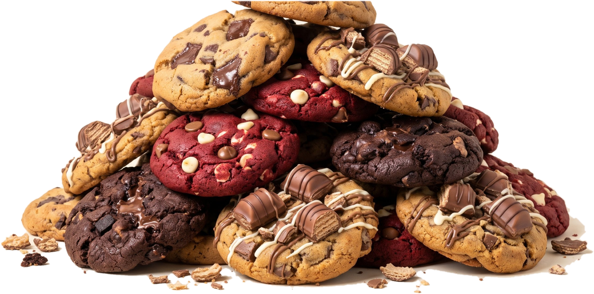

<p align="center"></p>

# La Cookie Locaa 🍪

> Sua Majestade decretou: cookies para todos.

Site com as três receitas de cookies da La Cookie Locaa, cada uma para 6 cookies:

| Cookie | O que é |
|---|---|
| **Cookie de Chocolate Recheada** | Massa de chocolate com recheio de mousse de chocolate |
| **Cookie Kinder Bueno** | Com pedaços de Kinder Bueno e recheio de Nutella |
| **Cookie Red Velvet** | Red velvet com chocolate branco e de leite |

## O que o site faz

- **Página inicial**: hero, as três cookies (foto, nome, tempo e nível), o monte de cookies, "Sobre mim" e vantagens. Carregar numa cookie abre a receita, com uma cortina dessa cookie pelo meio.
- **Foto do "Sobre mim"**: põe a tua foto em `assets/img/eu.jpg` (enquanto não existir, aparece uma cookie).
- **Cortina vista de cima** (opcional): imagens em `assets/img/topo/` e `topo: "assets/img/topo/<nome>.png"` na receita.
- **Página de cada cookie**, organizada em três etapas, com uma barra fixa para saltar entre elas:
  1. **O que precisas**: equipamento, "antes de começar" e ingredientes em gramas e chávenas/colheres (líquidos em ml), com doses ajustáveis e vistos.
  2. **Preparação**: cronologia com os passos numerados e agrupados por fase (por exemplo, Recheio → Massa → Moldar → Forno → Decorar), com temporizadores; toca num passo para o marcar como feito.
  3. **Servir e guardar**: como servir, conservar e congelar.
  No fim aparecem as outras receitas.
- **Lista de compras** (`lista.html`): um talão que junta e soma os ingredientes das receitas escolhidas.
- **Livro de receitas**: [`livro.html`](livro.html) para imprimir, ou o PDF em [`docs/`](docs/Livro-La-Cookie-Locaa.pdf).

## Estrutura

```
kingGcookies/
├── index.html            ← página inicial
├── lista.html            ← lista de compras (talão)
├── cookie-chocolate-recheada.html  ← páginas das receitas (geradas, ver abaixo)
├── cookie-kinder-bueno.html
├── cookie-red-velvet.html
├── livro.html            ← livro de receitas para imprimir (A4)
├── css/
│   ├── estilo.css        ← cores, letras e layout da marca
│   └── fontes.css        ← fontes guardadas localmente
├── js/
│   ├── receitas.js       ← AS RECEITAS (muda quantidades e passos aqui)
│   └── app.js            ← a lógica do site
├── ferramentas/
│   ├── pagina.tpl        ← modelo das páginas das receitas
│   └── gerar.js          ← gera as páginas a partir do modelo
├── assets/
│   ├── img/              ← logo, cookies, ícones
│   └── fonts/
└── docs/
    └── Livro-La-Cookie-Locaa.pdf
```

## Mudar uma receita

Abre `js/receitas.js`. Cada receita tem `grupos` (ingredientes) e `passos`; cada passo tem uma `fase`, que define o agrupamento na cronologia.
As quantidades são para 6 cookies; o site faz as contas para outras doses.
Nos passos, `{N}` é trocado pelo número de cookies escolhido.

Se adicionares uma receita nova (ou mudares o nome ou a cor de uma), volta a gerar as páginas:

```bash
node ferramentas/gerar.js .
```

## Pôr o site online (GitHub Pages)

1. No GitHub, abre o repositório → **Settings** → **Pages**.
2. Em *Source* escolhe **Deploy from a branch**, branch `main`, pasta `/ (root)`.
3. Guarda. Em 1–2 minutos fica em `https://cookiept.github.io/kingGcookies/`.

## Ver no computador

Basta abrir o `index.html` no browser. Ou, numa pasta com o projeto:

```bash
python3 -m http.server
# depois abre http://localhost:8000
```

---

Fontes: Luckiest Guy (Apache 2.0), Bebas Neue, Caveat, DM Sans e Jost (SIL OFL), via Fontsource.
