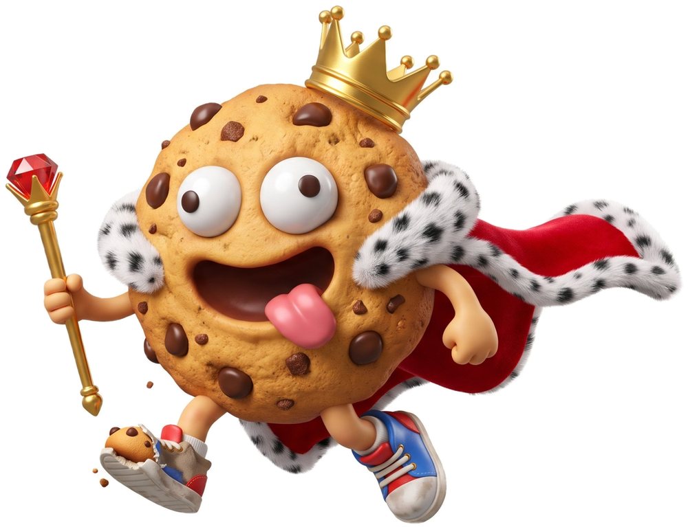

<p align="center"></p>

# Cookie's do King G 👑

> Sua Majestade decretou: cookies para todos.

Site com as três receitas de cookies do King G, cada uma para 6 cookies:

| Cookie | O que é |
|---|---|
| **O Rei Recheado** | Massa de chocolate com coração de mousse de chocolate |
| **O Bueno Real** | Kinder Bueno na massa, por cima e com coração de Nutella |
| **A Capa Vermelha** | Red velvet com chocolate branco e de leite |

## O que o site faz

- **Doses ajustáveis**: escolhe quantas cookies queres e as quantidades mudam sozinhas.
- **Ingredientes com visto**: vai riscando o que já está na taça (fica guardado no teu browser).
- **Temporizadores**: cada passo com tempo tem um botão; o alarme toca mesmo que estejas noutra parte do site.
- **Modo cozinha**: um passo de cada vez, em letra grande, com setas do teclado e temporizador.
- **Lista de compras**: junta as receitas que escolheres e soma as quantidades. Dá para copiar.
- **Livro de receitas**: [`livro.html`](livro.html) para imprimir, ou o PDF em [`docs/`](docs/Livro-Cookies-do-King-G.pdf).
- Carrega no Rei. 🍪

## Estrutura

```
kingGcookies/
├── index.html          ← o site
├── livro.html          ← livro de receitas para imprimir (A4)
├── css/
│   ├── estilo.css      ← cores, letras e layout da marca
│   └── fontes.css      ← fontes guardadas localmente
├── js/
│   ├── receitas.js     ← AS RECEITAS (muda quantidades e passos aqui)
│   └── app.js          ← a lógica (doses, temporizadores, modo cozinha…)
├── assets/
│   ├── img/            ← logo, cookies, ícones
│   └── fonts/          ← Luckiest Guy, Bebas Neue, Caveat, DM Sans, Jost
└── docs/
    └── Livro-Cookies-do-King-G.pdf
```

## Mudar uma receita

Abre `js/receitas.js`. Cada receita tem `grupos` (ingredientes) e `passos`.
As quantidades são para 6 cookies; o site faz as contas para outras doses.
Nos passos, `{N}` é trocado pelo número de cookies escolhido.

## Pôr o site online (GitHub Pages)

1. No GitHub, abre o repositório → **Settings** → **Pages**.
2. Em *Source* escolhe **Deploy from a branch**, branch `main`, pasta `/ (root)`.
3. Guarda. Em 1–2 minutos fica em `https://cookiept.github.io/kingGcookies/`.

## Ver no computador

Basta abrir o `index.html` no browser. Ou, numa pasta com o projeto:

```bash
python3 -m http.server
# depois abre http://localhost:8000
```

---

Fontes: Luckiest Guy (Apache 2.0), Bebas Neue, Caveat, DM Sans e Jost (SIL OFL), via Fontsource.
